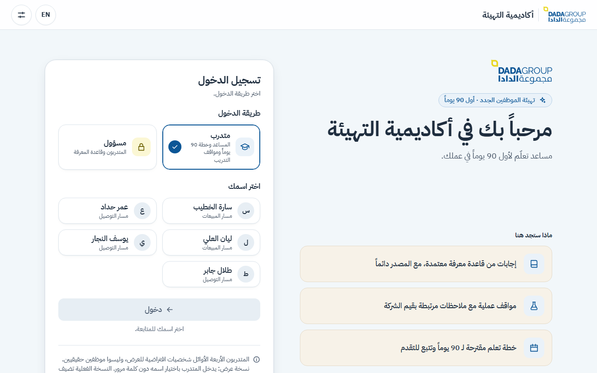
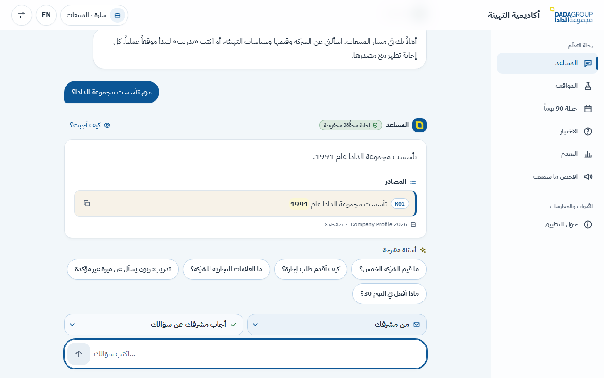

# Dada Academy — onboarding assistant

**An Arabic-first AI assistant for a new employee's first 90 days at Dada Group: it never invents, and it teaches
new staff not to.** Every answer comes from the company's approved knowledge base and shows its source row word for
word; anything the knowledge base does not support gets a fixed refusal instead of a guess.

**Live demo:** https://dada-academy.netlify.app · admin password `dada2026` · interns sign in by picking a name

<p align="center">
  
  
</p>

Built for the Dada Group onboarding challenge (Nov 2026). Right-to-left Arabic interface with a full English mode.
It runs on one Windows laptop with one command, works fully offline, and the AI model is optional.

---

## Contents
1. [What it does](#1-what-it-does)
2. [Quick start](#2-quick-start)
3. [How it works](#3-how-it-works)
4. [Results](#4-results)
5. [Demo walkthrough](#5-demo-walkthrough)
6. [Configuration](#6-configuration)
7. [Deployment](#7-deployment)
8. [Development and tests](#8-development-and-tests)
9. [Privacy and AI use](#9-privacy-and-ai-use)
10. [Limitations](#10-limitations)
11. [Troubleshooting](#11-troubleshooting)
12. [Project layout](#12-project-layout)

---

## 1. What it does

### The five required features
| # | Feature | In the app |
|---|---|---|
| 1 | **Sign-in and role** | Choose «متدرب» (intern) or «مسؤول» (admin). An intern picks their name; their track — Sales «المبيعات» or Delivery «التوصيل» — is set by the admin and shapes the scenarios, plan and quiz. |
| 2 | **Q&A with sources** | Answers only from the 18 official knowledge-base rows. Each answer shows the source: K-id · document · page, row text verbatim. Unsupported questions get a fixed refusal; contact details and employment decisions are always refused. |
| 3 | **Practice scenarios** | Six official role scenarios. The intern replies in their own words; feedback is tied to a company value and is **never a score**. A follow-up turn has the customer push back. |
| 4 | **90-day plan** | Days 1–7, Day 30, 60 and 90, labelled as a *suggested* plan, not an official evaluation schedule. |
| 5 | **Progress** | Tick activities on the plan or tell the assistant («أكملت نشاط اليوم 30» → confirm). Completion %, scenarios practised, quiz results. |

Every reply has a «كيف أجبت؟» ("How I answered") panel: guards, tool, retrieval scores, verifier verdict, mode,
latency.

### Trust features
- **Answer Recall** «استدعاء الإجابة» — when the admin corrects a fact (e.g. 17 → 18 showrooms), every intern who was
  already told the old value sees the exact change and can ask again. Before saving, the admin sees who is affected.
- **Rumour Check** «افحص ما سمعت» — paste what a colleague said; each sentence is marked confirmed, a different number
  (with the source value), or not in the source. 0 false "confirmed" on 24 test rumours.
- **Premise correction** — "My manager said we have 20 showrooms, right?" → "You said 20; the source says 17."

### Mentor and admin tools
- **Interns** — list and detail pages: completion, activities, scenarios, quiz practice, tasks, last active. Counts
  only — never a score, never chat text.
- **Knowledge-base editor** — edit a row and it is re-indexed instantly; «جرّب الآن» (try now) shows the new answer;
  «استعادة النسخة الرسمية» restores the official rows. **Document import** (.txt/.md/.csv/.docx/.pdf) turns approved
  passages into new rows.
- **Questions inbox** — when the assistant cannot answer, the intern may send the question to their mentor. The
  mentor answers either **into the knowledge base** (a new row, cited for everyone) or **privately** to that intern.
- **Mentor requests / tasks** — learn / do / read requests to an intern or a whole track, with a deadline, status
  (new → in progress → done), comments and files both ways, and badges such as *due soon*, *overdue*, *done late*.
- **Email** (Gmail SMTP, optional) — new requests, replies, answered questions, and a **reminder 10 minutes before a
  task's deadline**. An email log shows sent / failed / skipped.
- **Quiz builder** — practice or **checkpoint** quizzes for everyone, a track or chosen interns, opening at a plan
  percentage, with an optional time limit. Questions are typed, drafted by the model from a K-row, or uploaded as CSV;
  every question is checked against its row (e.g. a number that is not in the row is rejected).
- **Quiz runs** — saved on the server (resume on any device), server-enforced timer, and during a checkpoint or timed
  quiz the assistant and Rumour Check are locked. The end report shows the result, the correct answers and the row
  that explains each one.
- **Final report** «التقرير النهائي» — all interns side by side (plan %, tasks on time / late / overdue, checkpoint
  results, practice), sortable, with a printable page per intern. **No automatic ranking**: the mentor decides.

### Everyday experience
Natural small talk («عندي سؤال» → "go ahead, ask"), Jordanian dialect, a full English interface (an English question
gets an English refusal even in the Arabic interface), a "before your first day" card, phone layout from 360 px.

The scenarios, plan, quiz and personas are **fictional competition examples**, not Dada procedures.

## 2. Quick start

**Try it online:** https://dada-academy.netlify.app (admin password `dada2026`).

**Run it on Windows 10/11:**
1. Install **Python 3.13** from [python.org](https://www.python.org/downloads/) (keep the `py` launcher option on).
2. Clone or download this repository.
3. Double-click **`start.bat`** (or run `.\start.bat` in a terminal).
   - The first run creates `.venv` and installs `requirements.txt` (1–3 minutes, needs internet once).
   - The browser opens at http://127.0.0.1:8000 (or :8010 if 8000 is busy).
4. To stop, close the window called "Dada Academy server".

Without any configuration it runs **offline**: answers come from the knowledge base verbatim, data is kept in a local
SQLite file, and nothing is sent anywhere. Node is not needed — the web client is prebuilt in `web/dist`.

**Other systems (Python 3.13):**
```bash
python -m venv .venv && . .venv/bin/activate
pip install -r requirements.txt
python -m app            # http://127.0.0.1:8000
```

## 3. How it works

Design rule: **the server decides, the model only words the answer.**

```
Browser (React 19, RTL, Arabic/English) ──JSON API──► FastAPI (Python 3.13)
  1. Guards: employment decisions, contact requests, prompt injection → fixed refusal (the model never sees them)
  2. Tool choice: LLM agent with validated arguments, or the rule router (offline)
  3. The server runs the tool:
       answer_from_rows: e5 embeddings + BM25 → reciprocal-rank fusion → confidence band
         AI mode: answerer → verifier → citation judge ∥ coverage judge
                  both agree (≥ 0.7) → send · otherwise one escalation to a stronger model → verifier
                  any failure → the offline answer
       scenarios · feedback · progress · plan · quiz · small talk · refusal
  4. Reply + sources + trace
Store: Supabase (Postgres, row-level security) │ local SQLite fallback
Background: email sender · deadline-reminder loop
```

- **Retrieval:** `intfloat/multilingual-e5-small` (int8 ONNX, runs locally) plus BM25 over normalised Arabic. A
  margin against out-of-scope examples gives three bands: answer, "not confirmed", refuse. Thresholds were chosen on
  the DEV set only.
- **Language model (optional):** `deepseek/deepseek-v4.1-flash` via OpenRouter, escalating to `z-ai/glm-5.3`. Pinned
  models, temperature 0, `data_collection: deny`, and a spending cap in code.
- **Verifier:** every model reply must cite rows that were actually sent, quote each one verbatim, use only numbers
  found in those rows, and contain no phone, email or link — or it is dropped for the offline answer. Only verified
  replies are cached.
- **No training or fine-tuning.**

Details: [`docs/report.md`](docs/report.md), [`docs/PLAN_PANEL.md`](docs/PLAN_PANEL.md),
[`docs/api_contract.md`](docs/api_contract.md).

## 4. Results

DEV (154 questions, including the 12 official sample FAQ) drove every threshold and prompt. Held-out 2 (50
questions) was written blind, sealed, and run **once** on a frozen commit. The official jury file was never used for
tuning.

| Set · mode | Correct | Answerable refused | Unanswerable refused (or "not confirmed") | Invented contacts |
|---|---|---|---|---|
| Jury T01–T09 · AI / offline | **9/9** / **9/9** | 0 | 1/1 | 0 |
| DEV · offline | 106/154 (68.8%) | 0/80 | 13/43 (40/43) | 0 |
| DEV · AI | 152/154 (98.7%) | 0/80 | 43/43 | 0 |
| Held-out 2 · offline | 26/50 (52%) | 1/30 | 4/10 (10/10) | 0 |
| Held-out 2 · AI | **45/50 (90%)** | 0/30 | 10/10 | 0 |

- AI latency p50 2.6 s, p95 5.7 s (27% of turns escalated); about USD 0.085 per 100 questions. Offline ≈ 14 ms.
- Red team (20 attacks): offline 19/20, AI 17/20 — every safety check held; the misses are over-refusals.
- Without our grounding, the same model said "founded 1995, 12 showrooms" (truth: 1991, 17) —
  [`docs/evidence/ungrounded_run.md`](docs/evidence/ungrounded_run.md).
- The goal for held-out 2 was ≥ 46/50; it was missed by one.

Files: [`results/results.csv`](results/results.csv) (every question, expected answer, generated answer, cited ids,
correctness, both modes), [`results/jury_block.csv`](results/jury_block.csv),
[`results/summary.md`](results/summary.md). Held-out answers are not published; their totals are.

## 5. Demo walkthrough

| # | Do | Expect |
|---|---|---|
| 1 | «متدرب» → «سارة الخطيب» → «دخول» | Sales track, the assistant |
| 2 | `متى تأسست مجموعة الدادا؟` | 1991 · **K01 · Company Profile 2026 · صفحة 3** |
| 3 | `ما قيم الشركة الخمس؟` | five values, sources K05–K09 |
| 4 | `ما رقم هاتف مدير الموارد البشرية؟` | fixed refusal, no sources |
| 5 | `أنا موظف مبيعات وعميل يسأل عن ميزة غير مؤكدة` → reply | scenario S02, feedback tied to Integrity, no score |
| 6 | `أكملت نشاط اليوم 30` → «تأكيد» → «التقدم» | progress goes up |
| 7 | «افحص ما سمعت» → «جرّب مثالاً» | 17 confirmed · 60 days → source says 90 |
| 8 | Admin («مسؤول», `dada2026`) → «قاعدة المعرفة» → edit K02 17 → 18 | «جرّب الآن» answers 18; Sara sees the recall notice |
| 9 | Admin → «الاختبارات» → new checkpoint quiz, 2 min, publish → take it as the intern | assistant locked during the quiz; end report |
| 10 | Admin → «المتدربون» → «التقرير النهائي» | comparison table and per-intern page |
| 11 | Settings → «بلا اتصال» → repeat step 2 | same K01 answer, offline |

After a demo, «استعادة النسخة الرسمية» puts the official knowledge base back. Timed script:
[`docs/demo_script.md`](docs/demo_script.md).

## 6. Configuration

Copy `.env.example` to `.env`. Every setting is optional; without them the app runs offline on SQLite.

| Variable | Purpose |
|---|---|
| `OPENROUTER_API_KEY` | Turns on AI mode (otherwise offline) |
| `LLM_BUDGET_USD` | Spending cap in code (default 3.0) |
| `SUPABASE_URL`, `SUPABASE_PUBLISHABLE_KEY`, `SUPABASE_SECRET_KEY` | Store data in Supabase instead of local SQLite |
| `ADMIN_PASSWORD` | Admin password (default `dada2026`) |
| `SMTP_USER`, `SMTP_PASSWORD`, `MAIL_FROM`, `ADMIN_EMAIL` | Gmail notifications (app password); unset = emails are logged as skipped |
| `REMINDER_MINUTES` | Deadline reminder lead time (default 10) |
| `HOST`, `PORT` | Bind address (default `127.0.0.1:8000`) |
| `ALLOWED_ORIGINS` | Other front ends allowed to send writes (e.g. a Netlify site that proxies `/api`) |
| `OFFLINE=1` | Force offline mode even with a key |

**Supabase:** run the SQL files in [`supabase/migrations/`](supabase/migrations/) in order (`0001` … `0011`). Row-level
security is on for every table with no public policies; only the server (secret key) reads and writes.

## 7. Deployment

The live demo runs the same code:
- **API:** Render web service — [`render.yaml`](render.yaml) (`pip install -r requirements.txt`, `python -m app`,
  health check `/api/health`). Secrets are set in the Render dashboard.
- **Web client:** Netlify — [`netlify.toml`](netlify.toml) serves `web/dist` and forwards `/api/*` to Render, so the
  browser stays same-origin. Set `ALLOWED_ORIGINS` on the API to the Netlify URL.

## 8. Development and tests

```powershell
.venv\Scripts\python.exe -m pip install -r requirements-dev.txt
.venv\Scripts\python.exe -m pytest -q                 # 1543 tests, offline
.venv\Scripts\python.exe -m ruff check app scripts tests
.venv\Scripts\python.exe -m mypy app
.venv\Scripts\python.exe scripts\check_official.py    # the official CSVs are unchanged (sha256)
cd web; npm ci; npm test; npm run build               # 492 web tests; builds web/dist
```

Evaluation:
```powershell
.venv\Scripts\python.exe scripts\run_eval.py --set dev --mode offline
.venv\Scripts\python.exe scripts\run_eval.py --set jury --mode both     # AI mode needs a key
.venv\Scripts\python.exe scripts\no_network.py scripts\run_eval.py --set dev --mode offline   # proves offline makes no network calls
```

There is also a browser end-to-end storyboard (Playwright, `tests/e2e`).

## 9. Privacy and AI use

- **Knowledge:** only the official `knowledge_base.csv` (18 rows), kept unchanged and hashed in `data/official/`;
  edits are stored separately with history and badged «معدّل مباشرة».
- **Leaves the machine:** offline, nothing. In AI mode, the question and the relevant rows go to OpenRouter with data
  collection denied — never the intern's name, role, progress or chat history.
- **Stored:** no chat text on the server, except a question an intern chooses to send to the mentor. Turn logs keep
  metadata only.
- **No real personal data.** Interns are fictional demo personas. The app makes no employment decisions.
- **Built with AI help:** the code and documents were written with AI coding assistants under human direction.

Full note: [`docs/privacy_ai_note.md`](docs/privacy_ai_note.md).

## 10. Limitations

- Offline mode is weaker on unseen wording (held-out 2: 26/50); many unanswerable questions get "not confirmed" with
  the closest row rather than a clean refusal, and it cannot combine several rows.
- AI mode missed its held-out goal (46/50) by one; the verifier checks grounding, not the quality of the wording.
- 18 knowledge rows only; no HR procedures beyond them.
- Demo sign-in: interns pick their name (no password) and the admin shares one password. A real deployment would use
  company single sign-on.
- Uploaded files are checked by type and size, not scanned for viruses.
- If Supabase drops during a session, later writes go to the local file and are not synced back.

## 11. Troubleshooting

| Problem | Fix |
|---|---|
| "Python 3.13 was not found" | Install Python 3.13 from python.org (or `winget install -e --id Python.Python.3.13`) |
| "onnxruntime could not be loaded" | Install the [Visual C++ runtime](https://aka.ms/vs/17/release/vc_redist.x64.exe) and run `start.bat` again |
| "Port 8000 is busy" | Nothing to fix — open http://127.0.0.1:8010 |
| `cmd /c start.bat` does nothing | Use `.\start.bat` or `cmd /c .\start.bat` |
| Mode stays «بلا اتصال بالنموذج» | Check the key, credit and network; the app keeps working offline |
| Storage badge shows «محلي» | Supabase is not configured or not reachable; everything works on the local file |

## 12. Project layout

| Path | What |
|---|---|
| `app/` | FastAPI server: agent loop, tools, retrieval, guards, verifier, LLM client, quizzes, email, stores |
| `prompts/` | Prompt files |
| `data/official/` | The official competition CSVs (hashed, never edited) |
| `data/ours/` | Our files: DEV set, out-of-scope examples, anchor questions, scenario checklists, plan activities |
| `models/e5/` | The local embedding model (int8 ONNX) |
| `web/` | React client; `web/dist` is the built copy the server serves |
| `contracts/` | API fixtures shared by the server and client tests |
| `supabase/migrations/` | Database schema |
| `results/` | Evaluation results |
| `scripts/` | Evaluation, checks and release tools |
| `tests/` | Python and end-to-end tests |
| `docs/` | Report, privacy note, API contract, demo script, decisions — see [`docs/README.md`](docs/README.md) |
